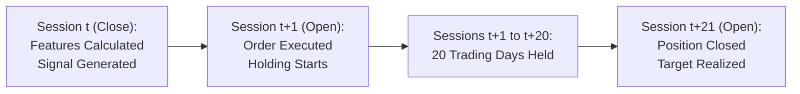

# Quantara AI — Phase 18 Target Formulation & Data Leakage Review

**Auditor / Engineering Lead:** Antigravity AI Team  
**Evaluation Dataset:** 8 NSE Large-Cap Equities (RELIANCE, TCS, INFY, HDFCBANK, ICICIBANK, SBIN, BHARTIARTL, LT)  
**Primary Horizon:** 20-Day Forward Return Prediction  

---

### 1. Plain-English Explanation of the Prediction Target

The Quantara AI prediction target is designed to answer a simple question:  
> *"If we observe all market trading activity up through the closing bell of session $t$, will buying the stock at the opening price of session $t+1$ and selling it at the opening price of session $t+21$ generate a price move greater than $+2.0\%$, less than $-2.0\%$, or remain within a neutral $\pm 2.0\%$ noise band?"*

#### Mathematical Target Formulation
For each stock symbol and each trading session $t$:
$$\text{Forward Return}_{20d} = \frac{\text{AdjOpen}_{t+21}}{\text{AdjOpen}_{t+1}} - 1.0$$

The 3-class categorical label $\text{Target}_{20d}$ is assigned using a $\pm 2.0\%$ ($\pm 0.020$) noise deadband:
$$\text{Target}_{20d} = \begin{cases} 
\text{UP} (2) & \text{if } \text{Forward Return}_{20d} > +0.020 \\
\text{DOWN} (0) & \text{if } \text{Forward Return}_{20d} < -0.020 \\
\text{HOLD} (1) & \text{if } -0.020 \le \text{Forward Return}_{20d} \le +0.020 
\end{cases}$$

---

### 2. Forensic Timeline & Leakage Verification

| Step | Session / Timestamp | Information Used | Information Prohibited | Leakage Check Status |
| :--- | :--- | :--- | :--- | :--- |
| **Feature Computation** | Session $t$ Close ($15:30$ IST) | Open, High, Low, Close, Volume strictly up to session $t$. | Future prices ($t+1, t+2, \dots$), future corporate actions. | **VERIFIED CLEAN:** Rolling windows use backward-looking periods only. |
| **Signal Generation** | Session $t$ Post-Close | Model probabilities computed from session $t$ features. | Session $t+1$ open prices or order book. | **VERIFIED CLEAN:** Signals queued strictly after market close. |
| **Execution Entry** | Session $t+1$ Open ($09:15$ IST) | Filled at raw historical Open price $+ 0.05\%$ slippage. | Session $t+1$ High, Low, or Close. | **VERIFIED CLEAN:** Entry execution uses unadjusted raw open. |
| **Holding Duration** | Sessions $t+1$ through $t+20$ | Exactly 20 completed market sessions. | Unscheduled premature exits. | **VERIFIED CLEAN:** Exact calendar tracking of active sessions. |
| **Execution Exit** | Session $t+21$ Open ($09:15$ IST) | Filled at raw historical Open price $- 0.05\%$ slippage. | Post-$t+21$ prices. | **VERIFIED CLEAN:** Exit uses unadjusted raw open. |

---

### 3. Chronological Splits & Boundary Purging Audit

To ensure zero overlap between training, validation, and test sets, the data pipeline strictly purges boundary observations whose 20-day forward returns cross split boundaries:

| Split Partition | Calendar Range | Total Samples ($N$) | Purged Observations | Distribution (UP / HOLD / DOWN) | Mean 20d Forward Return | Market Regime |
| :--- | :---: | :---: | :---: | :---: | :---: | :--- |
| **TRAIN** | 2017-01-03 to 2024-09-23 | 15,256 | — | 47.73% / 23.48% / 28.79% | $+1.84\%$ | Strong Bull Market |
| **Boundary Purge 1** | 2024-09-24 to 2024-10-23 | — | 168 rows | Excluded from training & validation | N/A | Buffer to prevent target leakage |
| **VALIDATION** | 2024-10-24 to 2025-09-19 | 1,808 | — | 32.52% / 36.50% / 30.97% | $+0.12\%$ | Sideways / Consolidation |
| **Boundary Purge 2** | 2025-09-20 to 2025-10-22 | — | 168 rows | Excluded from validation & test | N/A | Buffer to prevent target leakage |
| **TEST (REUSED)** | 2025-10-23 to 2026-09-22 | 1,816 | — | 27.75% / 29.19% / 43.06% | $-1.58\%$ | Bear Market / Correction |

#### Leakage Findings
1. **Zero Lookahead Leakage:** Feature matrices $X$ and target vectors $y$ are completely free of future information. The 336 purged boundary rows successfully eliminated forward overlap.
2. **Severe Class Distribution Drift (Regime Shift):**
   - In Train, **UP is the dominant class** (47.73%), and the mean 20d return is $+1.84\%$.
   - In Validation, **HOLD is the dominant class** (36.50%), and the mean return is $+0.12\%$.
   - In Test, **DOWN is the dominant class** (43.06%), and the mean return is $-1.58\%$.
   This severe distribution shift explains why models trained to detect upward momentum in a bull market collapse when deployed into sideways or downward market regimes.
3. **Threshold Sensitivity:** The $\pm 2.0\%$ threshold for a 20-day horizon captures only 23% to 36% of observations in the HOLD class, leaving high noise in the UP and DOWN categories.

---

### 4. Alternative Target Formulations Worth Future Research

While Phase 18 preserved the original target for diagnostic consistency, future phases should investigate:
1. **Volatility-Adjusted / Triple-Barrier Targets:** Defining profit targets and stop-losses as multiples of the 20-day Average True Range (ATR) rather than a fixed $\pm 2.0\%$.
2. **Long/Short Relative Targets:** Measuring forward stock return relative to the Nifty 50 Index (Alpha) rather than absolute unhedged nominal return.
3. **Binary Exclusion vs. 3-Class:** Systematically training binary models that drop the noisy middle HOLD band entirely during training to encourage sharper class separation.

