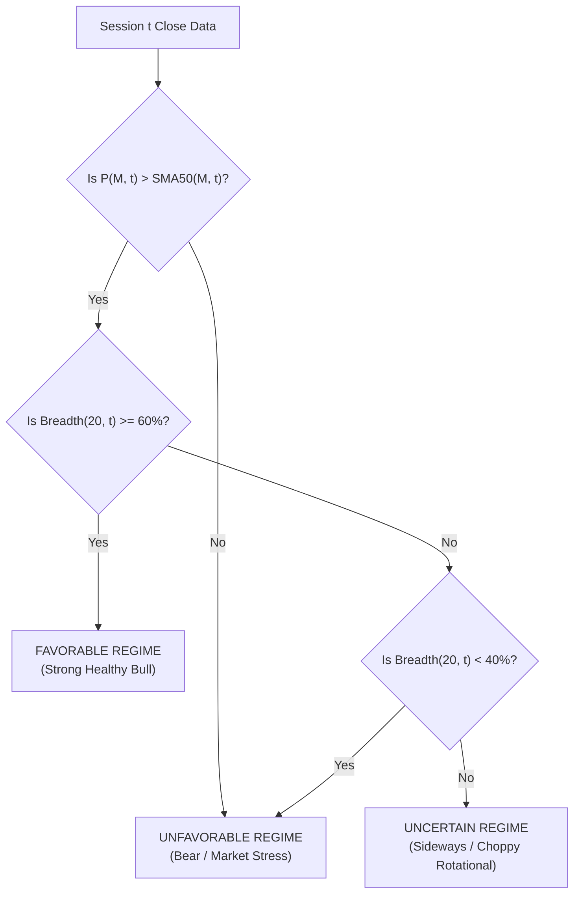

# QUANTARA AI — PHASE 20 METHODOLOGY
## Causal Market-Regime Detection, Dynamic Cash Allocation, and Rigorous Portfolio Simulation

**Author:** Quantara AI Research Agent  
**Date:** October 2026  
**Audited Location:** `reports/phase20_regime_allocation/phase20_methodology.md`  

---

### 1. Market Proxy and Regime Indicator Formulations

To prevent single-stock idiosyncrasies from distorting broad market classification, an authentic aggregate market proxy was constructed across the $K = 8$ large-cap stocks in the audited universe (RELIANCE, TCS, INFY, HDFCBANK, ICICIBANK, SBIN, BHARTIARTL, LT).

#### A. Synthetic Equal-Weight Market Index
For each trading day $t$, the daily composite market index $P_{M, t}$ is defined by:
$$P_{M, t} = P_{M, t-1} \times \left(1 + \frac{1}{K} \sum_{k=1}^K \frac{Close_{k, t} - Close_{k, t-1}}{Close_{k, t-1}}\right)$$
with initial normalized base $P_{M, 0} = 100.0$.

#### B. Market Trend Indicator (50-Day Moving Average)
The market trend benchmark is calculated as the 50-day simple moving average of the composite index:
$$SMA50_{M, t} = \frac{1}{50} \sum_{i=0}^{49} P_{M, t-i}$$

#### C. Market Breadth Indicators
Market breadth captures the internal participation of individual constituent stocks.
1. **Short-Term Breadth (20-day SMA):**
   $$Breadth_{20, t} = \frac{1}{K} \sum_{k=1}^K \mathbb{I}\left(Close_{k, t} > SMA20_{k, t}\right) \times 100\%$$
2. **Intermediate-Term Breadth (50-day SMA):**
   $$Breadth_{50, t} = \frac{1}{K} \sum_{k=1}^K \mathbb{I}\left(Close_{k, t} > SMA50_{k, t}\right) \times 100\%$$
   where $\mathbb{I}(\cdot)$ is the indicator function returning 1 if true and 0 otherwise.

#### D. Realized Annualized Volatility
The 20-session rolling annualized market volatility is computed from daily log returns $r_{M, t} = \ln(P_{M, t} / P_{M, t-1})$:
$$\sigma_{M, t} = \sqrt{\frac{252}{19} \sum_{i=0}^{19} \left(r_{M, t-i} - \bar{r}_{M, t}\right)^2} \times 100\%$$

---

### 2. Causal Regime State Logic

At the end of session $t$ (using data strictly known at or before market close), the system assigns the market state for session $t+1$:

#### Precise Mathematical Criteria
1. **Favorable Regime ($\mathcal{R}_{t} = \text{FAVORABLE}$):**
   $$\left(P_{M, t} > SMA50_{M, t}\right) \quad \land \quad \left(Breadth_{20, t} \ge 60\%\right)$$
   *Economic Interpretation:* Broad-based institutional participation with positive market trend. Full equity allocation permitted.
2. **Unfavorable Regime ($\mathcal{R}_{t} = \text{UNFAVORABLE}$):**
   $$\left(P_{M, t} \le SMA50_{M, t}\right) \quad \lor \quad \left(Breadth_{20, t} < 40\%\right)$$
   *Economic Interpretation:* Severe institutional distribution, macro downtrend, or market breadth collapse. High risk of false breakouts. 100% Cash allocation enforced.
3. **Uncertain Regime ($\mathcal{R}_{t} = \text{UNCERTAIN}$):**
   All remaining intermediate states:
   $$\left(P_{M, t} > SMA50_{M, t}\right) \quad \land \quad \left(40\% \le Breadth_{20, t} < 60\%\right)$$
   *Economic Interpretation:* Rotational or consolidating market. Defensive allocation (50% max equity cap, reduced individual position sizing).

---

### 3. Dynamic Cash Yield Accounting

Unlike simplistic backtests that assume cash earns zero interest or uncollateralized interbank overnight rates, Phase 20 models three explicit cash yield tiers:

1. **Tier 1: Idle Trading Cash ($r_{\text{annual}} = 0.0\%$):**
   Reflects funds sitting idle in a non-interest-bearing trading ledger.
2. **Tier 2: Net Cash Equivalent ($r_{\text{annual}} = 5.2\%$):**
   Reflects cash parked overnight in high-quality Indian Liquid / Overnight Mutual Funds (e.g., SBI Liquid Fund or ICICI Prudential Liquid Fund).
   - Gross underlying repo rate: $6.50\%$
   - Total Expense Ratio (TER): $\sim 0.25\%$
   - Capital gains tax drag (assuming corporate or individual short-term bracket of 20% effective tax): $\sim 1.05\%$
   - Realized Net Annual Yield: $5.20\%$
3. **Tier 3: Gross Cash Benchmark ($r_{\text{annual}} = 6.5\%$):**
   Reflects theoretical gross RBI repo rate with zero tax and zero fees.

#### Daily Compounding Accrual Formula
Cash earns daily interest based on actual 365 calendar days:
$$r_{\text{daily}} = (1 + r_{\text{annual}})^{1/365} - 1$$
For each trading day $t$, cash balance updating is governed by:
$$\text{Cash}_{t} = \text{Cash}_{t-1} \times \left(1 + r_{\text{daily}}\right)^{\Delta \text{days}} + \Delta \text{Cash}_{\text{trading}, t}$$
where $\Delta \text{days}$ represents calendar days elapsed since the prior trading session (e.g., 3 days across weekends), and $\Delta \text{Cash}_{\text{trading}, t}$ represents net cash flows from stock purchases, sales proceeds, commissions, and dividend credits.

---

### 4. Realistic Execution and Fee Schedules

To ensure complete empirical validity, every executed order incorporates realistic transaction friction based on Indian cash delivery market regulations:

1. **Slippage Model:**
   $$P_{\text{exec, buy}} = P_{\text{close, } t} \times (1 + 0.0005)$$
   $$P_{\text{exec, sell}} = P_{\text{close, } t} \times (1 - 0.0005)$$
2. **Statutory & Exchange Costs (Delivery):**
   - Securities Transaction Tax (STT): $0.10\%$ on Buy value, $0.10\%$ on Sell value.
   - NSE Exchange Turnover Fee: $0.00297\%$ on total traded value.
   - SEBI Regulatory Fee: $0.0001\%$ (₹10 per crore).
   - Stamp Duty: $0.015\%$ on Buy value.
   - Goods & Services Tax (GST): $18.0\%$ on (Exchange Turnover Fee + SEBI Fee).
   - Depository Participant (DP) Charge: Flat ₹15.93 per stock sell order.
3. **Dividend Accounting:**
   Dividends announced during the holding window are credited to cash on the ex-dividend date:
   $$\text{Dividend Credit} = \text{Shares Held} \times \text{Dividend Per Share}$$

---

### 5. Evaluated Allocation Rules (A through F)

- **Rule A (Baseline LR, Pure Cash 0%):** Standard 20-day binary Logistic Regression baseline without regime conditioning. Idle cash earns 0.0%.
- **Rule B (Dynamic Breadth Switch):** Long positions only permitted when $Breadth_{20, t} \ge 50\%$. If breadth $< 50\%$, no new entries; existing positions held to natural exit. Cash earns 5.2% net yield.
- **Rule C (Dual Unfavorable Switch):** Long positions permitted only if $(Breadth_{20, t} \ge 50\%) \lor (P_{M, t} > SMA50_{M, t})$. If both fail, capital moves 100% to cash. Cash earns 5.2% net yield.
- **Rule D (Multi-Regime Tiered):**
  - Favorable: Max equity exposure 100%, max position size 20% of equity.
  - Uncertain: Max equity exposure 50%, max position size 10% of equity.
  - Unfavorable: Max equity exposure 0% (no new entries permitted). Cash earns 5.2% net yield.
- **Rule E (Heuristic Trend-Follower, No ML):**
  - Selects the top 2 stocks with highest 20-day return that are trading above their individual 50-day SMA, provided $P_{M, t} > SMA50_{M, t}$.
  - Equal-weighted 20% allocation per position; max 40% equity. Cash earns 5.2% net yield.
- **Rule F (ML-Plus-Regime Dynamic Alpha):**
  - Requires: Model probability $P(\text{Up}) > 0.55$, stock price $> SMA50$, and Market Regime $\ne \text{UNFAVORABLE}$.
  - Asymmetric exit: Hard stop-loss at $-5.0\%$, profit target at $+12.0\%$, max holding period 20 sessions. Cash earns 5.2% net yield.

