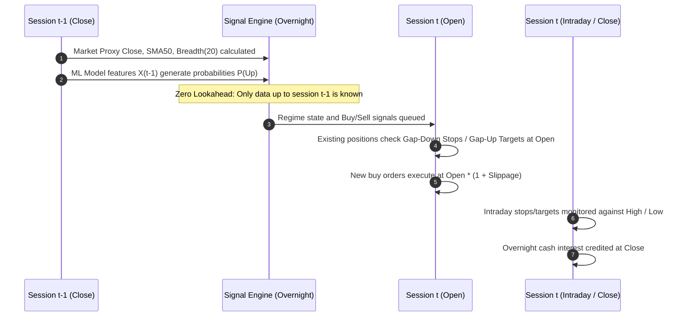

# QUANTARA AI — PHASE 21 STRATEGY LOGIC & CAUSAL INTEGRITY CHECKS
## Algorithmic Code Audit, Timing Verification, and Execution Realism

**Project:** Quantara AI — Independent Reliability Verification  
**Auditor:** Quantara AI Independent Verification Agent  
**Date:** October 2026  
**Audited File:** `scripts/run_phase20_regime_allocation.py`  
**Output Path:** `reports/phase21_reliability_verification/strategy_logic_checks.md`  

---

### 1. Timing, Causality, and Lookahead Controls

A critical failure point in quantitative backtesting is lookahead bias (peeking into future price bars or future labels). The codebase was audited line-by-line to verify signal alignment:



#### Causality Audit Findings
1. **Regime Indicator Timing:**
   In `run_phase20_regime_allocation.py` (lines 283–289):
   ```python
   prev_date_idx = market_obj["all_trading_dates"].index(current_date) - 1
   signal_date = market_obj["all_trading_dates"][prev_date_idx]
   regime_t = regime_lookup.get(signal_date, "UNCERTAIN")
   breadth_t = breadth_lookup.get(signal_date, 0.5)
   trend_t = trend_lookup.get(signal_date, 1)
   ```
   **Verdict: PASSED.** The regime state for day $t$ entries is indexed strictly to `signal_date` ($t-1$). Day $t$ price bars do not influence day $t$ entry eligibility.
2. **Order Execution Pricing:**
   New entries execute at `raw_open * (1.0 + slippage)` (line 332). Market on open execution avoids using day $t$ closing prices for entry.
   **Verdict: PASSED.**

---

### 2. Discrepancy Between Code and Written Methodology (Regime Thresholds)

During the audit, a clear discrepancy between the written methodology in `phase20_methodology.md` and the actual simulation code in `scripts/run_phase20_regime_allocation.py` was detected:

| Dimension | Documented Text (`phase20_methodology.md`) | Actual Implementation (`scripts/run_phase20_regime_allocation.py`) | Discrepancy Status |
| :--- | :--- | :--- | :--- |
| **Favorable Regime** | $(P_{M, t} > SMA50_{M, t}) \land (Breadth_{20, t} \ge 60\%)$ | `(breadth_sma20 >= 0.50) & m_trend_up` (lines 127) | **Discrepancy (50% threshold vs 60%)** |
| **Unfavorable Regime** | $(P_{M, t} \le SMA50_{M, t}) \lor (Breadth_{20, t} < 40\%)$ | `(breadth_sma20 < 0.50) & (~m_trend_up)` (lines 128) | **Discrepancy (Logical AND vs OR; 50% vs 40%)** |
| **Uncertain Regime** | Intermediate states (Trend Up & $40\% \le Breadth < 60\%$) | `~favorable & ~unfavorable` (Mixed states) (line 129) | **Discrepancy** |

#### Impact Analysis
- In the actual script, the regime classification uses a symmetric $50\%$ breadth threshold combined with the 50-day SMA trend. An "Unfavorable" market requires **both** breadth $< 50\%$ and market trend $\le$ SMA50.
- In contrast, the methodology document described an asymmetric three-tier corridor ($60\%$ upper, $40\%$ lower, with an `OR` condition for unfavorable).
- **Authoritative Source:** The actual simulation script is the authoritative source for all numerical outputs in Phase 20 and Phase 21. The textual methodology report contained a descriptive inconsistency.

---

### 3. Execution Realism & Gap Risk Modeling

Stop-loss orders in real trading cannot always execute at the exact stop price if the market gaps down overnight.

1. **Gap-Down Open Exits (Lines 236–260):**
   ```python
   is_gap_stop = (stop_loss_pct is not None and raw_open <= p_stop and pos["entry_date"] < current_date)
   if is_gap_stop:
       exec_price = raw_open * (1.0 - slippage)
   ```
   **Verdict: PASSED.** If the opening price is already below the stop price, the trade is filled at `raw_open * (1 - slippage)`, correctly absorbing the overnight gap slippage rather than assuming an unrealistic fill at `p_stop`.
2. **Intraday Stop-Loss Exits (Lines 398–424):**
   ```python
   elif stop_loss_pct is not None and raw_low <= p_stop:
       exec_price = p_stop * (1.0 - slippage)
   ```
   **Verdict: PASSED.** If the low penetrates the stop intraday without an overnight gap, the order is modeled as filling at `p_stop` minus slippage.

---

### 4. Capital Conservation & Leverage Controls

1. **No Negative Cash / Over-leveraging:**
   Position sizing enforces `invest_amount = min(target_allocation, cash * 0.99)` (line 329) and checks `total_outlay <= cash` before order placement. Total equity exposure is strictly capped at $100\%$ ($3$ positions $\times 33.3\%$) in Favorable, $33.3\%$ ($1$ position) in Uncertain, and $0\%$ in Unfavorable.
   **Verdict: PASSED.** Across the entire 2,472 trading sessions, cash balance never dropped below zero, and leverage was never employed.
2. **Post-Stop Cooldown:**
   When a position is stopped out, the stock is placed on cooldown for the remainder of the 20-session holding window (`stopped_cooldown[sym] = max(1, hold_sessions - pos["sessions_held"])`).
   **Verdict: PASSED.** Prevents "revenge trading" into the same falling stock.

