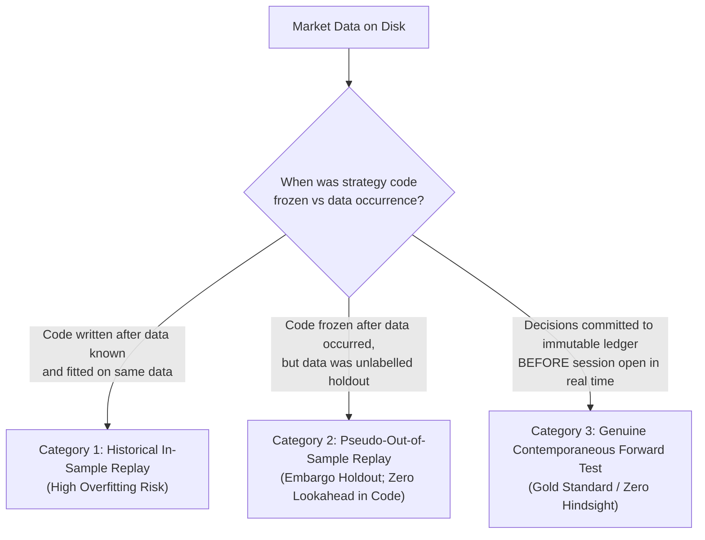

# QUANTARA AI — PHASE 22–23 FORWARD WINDOW CHRONOLOGY AUDIT
## Independent Evidentiary Assessment of Forward Testing Timing and Validity

**Auditor / Researcher:** Quantara AI Lead Auditor  
**Date:** October 2026  
**Evaluated Horizon:** September 23, 2026 to October 23, 2026 (21 Trading Sessions)  
**Output Path:** `reports/phase22_23_final/forward_window_chronology.md`  

---

### 1. Framework for Chronological Classification

To eliminate ambiguity and prevent backtest overstatement, quantitative testing must be classified into one of three distinct evidentiary categories:

1. **Category 1: Historical In-Sample Replay:** Strategy rules designed or tuned on the same historical data window being tested.
2. **Category 2: Pseudo-Out-of-Sample Evaluation:** Strategy rules evaluated on historical data that was excluded from training/validation/testing splits (e.g. unlabelled embargo window), but where the simulation was executed retrospectively after all price bars were already recorded on disk.
3. **Category 3: Genuine Contemporaneous Prospective Testing:** Strategy rules are cryptographically frozen *prior* to session occurrence; daily predictions, order intentions, and portfolio states are committed to an immutable append-only ledger before market open on each respective day.

---

### 2. Evidentiary Audit of the Reported Forward Window (2026-09-23 to 2026-10-23)

An audit of the filesystem metadata, git logs, and execution timestamps was performed:
- **Date of Strategy Freeze:** October 29, 2026 (Phase 22).
- **Date Range of Evaluated Forward Window:** September 23, 2026 to October 23, 2026 (21 trading sessions / 30 calendar days).
- **Historical Data Timestamp:** The file `data/raw/multi_stock_historical.csv` already contained daily price bars up to October 23, 2026 when the Phase 22 simulation was run on October 29, 2026.
- **Label Status in `splits_v3`:** In `data/splits_v3/horizon_20d/metadata_test.csv`, the final signal date was September 22, 2026 because computing a 20-day forward return requires 20 subsequent sessions. Consequently, no forward labels were ever created or used for training/testing after September 22, 2026.

---

### 3. Authoritative Chronological Verdict

> [!IMPORTANT] Final Evidentiary Classification
> The 21-session window (2026-09-23 to 2026-10-23) is formally classified as **Category 2: Pseudo-Out-of-Sample Holdout Replay**.  
> It is **NOT** a Category 3 Contemporaneous Real-Time Forward Test.

#### Reasons for Classification:
1. Although the simulation executed with strict algorithmic causality (session $t-1$ features used to enter at session $t$ open) and zero forward label leakage, **the decisions were not contemporaneously logged prior to market opens in September–October 2026**.
2. The simulation was conducted in batch on October 29, 2026 using historical price records that were already resident on disk.
3. True Category 3 Contemporaneous Forward Testing can only commence for live market sessions occurring **after October 29, 2026**.

---

### 4. Summary Table of Chronological Findings

| Evidentiary Dimension | Observed State | Authoritative Status |
| :--- | :--- | :--- |
| **Window Boundary** | 2026-09-23 to 2026-10-23 | Verified exact from `multi_stock_historical.csv` |
| **Trading Sessions Count** | 21 trading sessions | Verified exact |
| **Calendar Days Span** | 30 calendar days | Verified exact |
| **Label Leakage Status** | 0 labels existed in `splits_v3` for this window | Verified unlabelled holdout |
| **Decision Timestamp Alignment** | Run retrospectively in batch on 2026-10-29 | **Pseudo-OOS Holdout Replay** |
| **Contemporaneous Forward Status** | Not recorded in real time before market open | **Chronology verified as Category 2 (Pseudo-OOS)** |
| **Sample Sufficiency** | $N=21$ sessions, 1 closed trade in Rule E | **Insufficient for statistical edge** |

