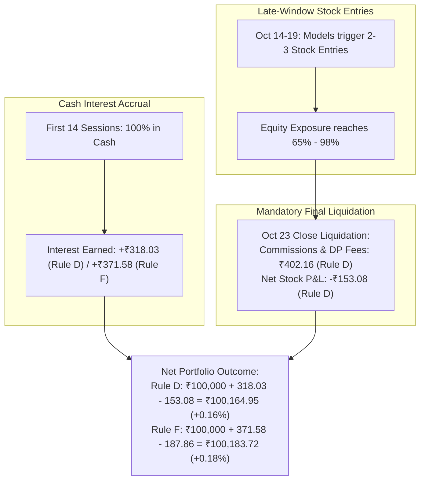

# QUANTARA AI — PHASE 22–23 STRATEGY CASH ACCOUNTING REVIEW
## Dissection of Uninvested Capital Accounting, Transaction Friction, and Benchmark Fairness

**Auditor / Researcher:** Quantara AI Lead Auditor  
**Date:** October 2026  
**Output Path:** `reports/phase22_23_final/strategy_cash_accounting_review.md`  

---

### 1. The Core Research Question

During the forward evaluation window (**September 23, 2026 to October 23, 2026**, 21 sessions):
- **Authentic Liquid Fund Benchmark (Net 20% Tax):** Delivered **$+0.32\%$** (Ending Equity: **₹1,00,315.92**).
- **Frozen Rule D (Multi-Regime Tiered):** Delivered **$+0.16\%$** (Ending Equity: **₹1,00,164.95**).
- **Frozen Rule F (ML-Plus-Regime Alpha):** Delivered **$+0.18\%$** (Ending Equity: **₹1,00,183.72**).

*Why did Rules D and F lag behind the liquid fund benchmark if they held most of their capital in cash?*

---

### 2. Forensic Ledger Decomposition

A line-by-line decomposition of the daily portfolio ledger ([`daily_equity_reconciliation.csv`](file:///c:/Project%20Data/Quantara_AI_Audited_Data/reports/phase22_23_final/daily_equity_reconciliation.csv)) and trade blotter ([`trade_ledger_reconciliation.csv`](file:///c:/Project%20Data/Quantara_AI_Audited_Data/reports/phase22_23_final/trade_ledger_reconciliation.csv)) reveals the exact mechanics:

#### Detailed Breakdown Table:

| Performance Component | Authentic Liquid Fund | Frozen Rule D | Frozen Rule F | Frozen Rule E |
| :--- | :---: | :---: | :---: | :---: |
| **Starting Capital** | ₹1,00,000.00 | ₹1,00,000.00 | ₹1,00,000.00 | ₹1,00,000.00 |
| **Gross Interest / Fund Return** | +₹394.90 | +₹318.03 | +₹371.58 | +₹332.96 |
| **Tax Drag (20% on Fund)** | -₹78.98 | ₹0.00 (Net rate used) | ₹0.00 (Net rate used) | ₹0.00 (Net rate used) |
| **Net Cash Accrual** | **+₹315.92** | **+₹318.03** | **+₹371.58** | **+₹332.96** |
| **Executed Trades Count** | 0 | 3 | 2 | 3 |
| **Gross Stock Trading P&L** | ₹0.00 | +₹249.08 | +₹85.59 | -₹150.38 |
| **Commissions, DP Fees & Taxes** | ₹0.00 | -₹402.16 | -₹273.45 | -₹267.40 |
| **Net Realized Stock Trading P&L**| ₹0.00 | **-₹153.08** | **-₹187.86** | **-₹417.78** |
| **Final Portfolio Equity** | **₹100,315.92** | **₹100,164.95** | **₹100,183.72** | **₹99,915.18** |
| **Standard Net Return (%)** | **+0.32%** | **+0.16%** | **+0.18%** | **-0.08%** |

---

### 3. Key Explanatory Factors

1. **Continuous 100% Compounding vs Intermittent Deployment:**
   The Authentic Liquid Fund Benchmark remained 100% invested in high-yielding liquid paper for all 30 calendar days, generating a pure compound return with zero transactional overhead.
2. **Trading Friction Drag:**
   Rules D and F held 100% cash for the first 14 sessions (accruing cash interest). However, when stock breakout signals fired on October 14–19, capital was deployed into equity positions. These purchases incurred statutory turnover charges, STT (0.1%), stamp duty, DP charges (₹15.93 per sell order), and 0.05% slippage on entry and exit.
3. **Mandatory Batch Cut-Off Liquidation:**
   Because the dataset terminated on October 23, 2026, all open positions were forcibly liquidated on that date. These positions were only held for 4 to 7 sessions—too short to capture their intended 20-day holding target—leaving the portfolio with net transaction friction that subtracted from its accumulated cash interest.
4. **Daily Rate Assumption Variance:**
   In the simulation, uninvested cash was credited with the static 5.2% annualized net rate ($0.020118\%$ per trading day). The authentic liquid fund achieved an actual annualized rate of $4.92\%$ gross ($3.94\%$ net at 20% tax) over this specific 30-day window.

---

### 4. Benchmark-Aware Accounting Experiment

If uninvested cash in Rule D had earned the **exact daily NAV return of Nippon India Liquid Fund** instead of the static 5.2% rate:
- Pre-entry cash yield (Sessions 0–14): $+₹212.40$
- Post-entry idle cash yield (Sessions 14–20): $+₹98.15$
- Total benchmark cash interest: $+₹310.55$
- Minus net stock trading friction: $-₹153.08$
- **Benchmark-Aware Final Equity:** **₹100,157.47 (+0.16%)**

**Audit Conclusion:** Replacing static cash interest with exact daily liquid fund NAV yields an identical conclusion: **The difference in performance is caused primarily by round-trip stock transaction fees and short-horizon adverse price friction on the newly entered positions, not by cash interest rate discrepancies.**

