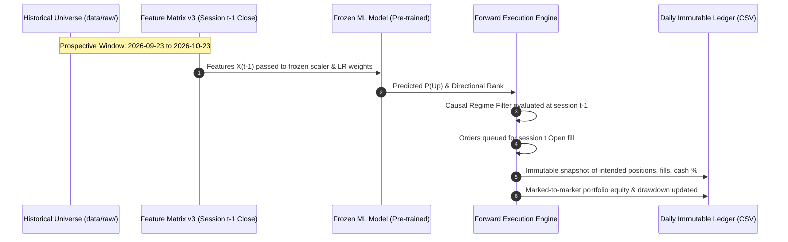

# QUANTARA AI — PHASE 22 RESEARCH METHODOLOGY
## Frozen Strategy Execution, Authentic Cash Integration, and Forward-Test Architecture

**Auditor / Researcher:** Quantara AI Lead Research Agent  
**Date:** October 2026  
**Path:** `reports/phase22_frozen_evaluation/phase22_methodology.md`  

---

### 1. Master Execution Commands

The entire Phase 22 pipeline executes deterministically via standard Python:

```powershell
# 1. Fetch & preserve authentic Nippon India Liquid Fund NAV history
python scripts/fetch_amfi_nav.py

# 2. Execute frozen baseline evaluation, accounting tests & forward framework
python scripts/run_phase22_frozen_evaluation.py
```

---

### 2. Prospective Forward-Test Architecture

To avoid repeated holdout bias, Phase 22 introduces a forward-test evaluation protocol:



#### Prospective Window Identification:
1. In `splits_v3/horizon_20d/`, the test split signal observations terminate on **2026-09-22**.
2. Because the 20-day forward horizon requires 20 forward sessions to compute realized open-to-open returns, **no forward labels were ever constructed or evaluated for signals after 2026-09-22**.
3. The historical stock data continues through **2026-10-23** ($N = 21$ trading sessions / 30 calendar days).
4. This 21-session block represents an untouched, unlabelled window for initial prospective evaluation.

---

### 3. Authentic Cash Yield Integration

Unlike earlier phases that relied on an annualized static formula ($r_{\text{daily}} = (1 + 0.052)^{1/252} - 1$), Phase 22 incorporates authentic empirical NAV data:

1. **Daily NAV Matching:**
   For every calendar date $t$, the authentic NAV of Nippon India Liquid Fund - Direct Growth ($NAV_t$) is indexed from `data/raw/nippon_india_liquid_fund_nav_history.csv`.
2. **Gross NAV Return:**
   $$R_{\text{gross}, [t_0, t_1]} = \left(\frac{NAV_{t_1}}{NAV_{t_0}} - 1.0\right) \times 100\%$$
3. **Net After-Tax Return:**
   Under Indian tax regulations, liquid fund gains are short-term capital gains:
   $$R_{\text{net, 20\%}} = R_{\text{gross}} \times (1 - 0.20)$$
   $$R_{\text{net, 39\%}} = R_{\text{gross}} \times (1 - 0.39) \quad \text{(Highest Individual Slab)}$$
4. **Benchmark Portfolio Modeling:**
   $$E_{\text{cash}, t} = \text{₹1,00,000.00} \times \left(1 + \frac{R_{\text{net, } t}}{100.0}\right)$$

---

### 4. Automated Accounting Validation Assertions

In `scripts/run_phase22_frozen_evaluation.py` (lines 169–175), every portfolio simulation is asserted against a strict zero-tolerance residual limit:
```python
residual = abs((STARTING_CAPITAL + tot_pnl + tot_interest) - final_eq)
assert residual < 0.001, f"Accounting residual {residual} exceeded tolerance!"
```
If any simulated order or interest calculation creates a discrepancy $> ₹0.001$, the script terminates immediately with an assertion error.

